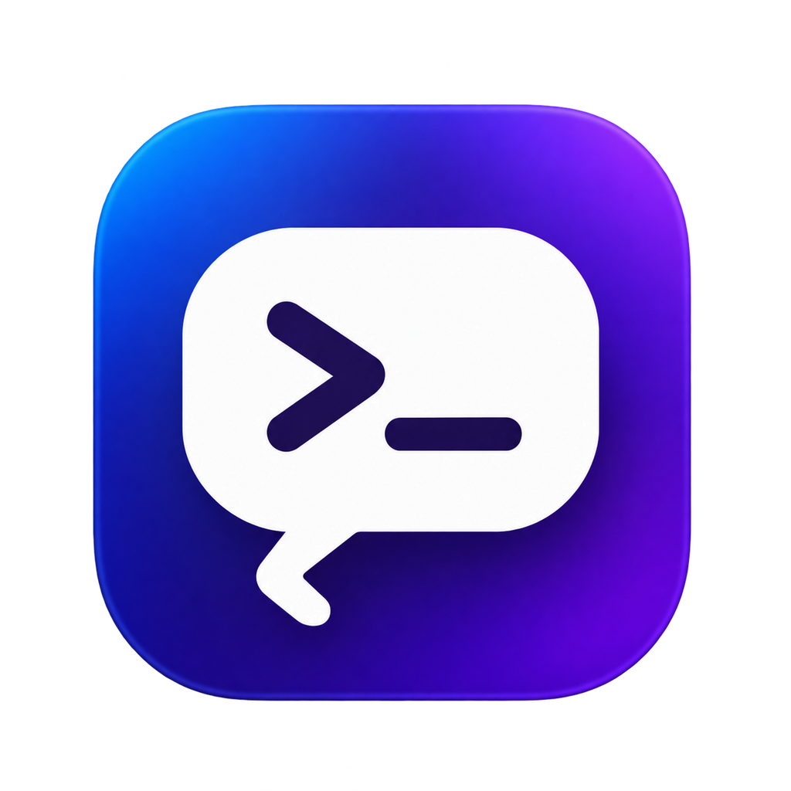

<p align="center"></p>

# Discode — Discord Code

개인 Discord 세션의 DM·서버 채널을 VS Code 스타일 편집기로 읽고, 아래쪽 TERMINAL에서 메시지를 보내는 데스크톱 앱입니다.

[자동 빌드와 다운로드](https://github.com/gwxodn020/discode/actions/workflows/build.yml)

## 다운로드

GitHub **Actions → Build desktop apps → 성공한 실행 → Artifacts**에서 사용 중인 환경을 선택하세요. 비공개 저장소이므로 저장소 접근 권한이 있는 GitHub 계정으로 로그인해야 합니다.

| 환경 | 아티팩트 | 설치 파일 |
|---|---|---|
| Mac Apple Silicon | `Discode-mac-arm64` | `Discode-버전-mac-arm64.dmg` |
| Mac Intel | `Discode-mac-x64` | `Discode-버전-mac-x64.dmg` |
| Windows Intel / AMD | `Discode-win-x64` | `Discode-버전-windows-x64-setup.exe` |
| Windows ARM | `Discode-win-arm64` | `Discode-버전-windows-arm64-setup.exe` |

DMG를 열어 앱을 Applications로 옮기거나, Windows 설치 프로그램을 실행합니다. `SHA256SUMS-*.txt`로 파일 해시를 확인할 수 있습니다.

현재 Mac은 ad-hoc 서명이며 Apple Developer ID 서명·공증, Windows는 배포용 인증서 서명이 적용되지 않았습니다. 따라서 다운로드한 앱을 실행할 때 OS 보안 안내가 표시될 수 있습니다. 자동 빌드·테스트가 배포용 코드 서명을 대신하지는 않습니다.

## 사용

1. 앱 안의 Discord 로그인 화면에서 직접 로그인합니다. QR·2단계 인증도 Discord 화면에서 진행합니다.
2. 로그인하면 코드 화면으로 전환됩니다. 왼쪽 탐색기의 서버 폴더와 `.py` 파일로 채널·DM을 선택합니다.
3. 목록에 없는 대화는 오른쪽 위 미리보기 아이콘으로 **원본 화면**을 열어 선택합니다.
4. 아래 **TERMINAL**의 전송 대상을 확인하고 메시지를 입력합니다. **Enter**로 전송하고 **Shift+Enter**로 줄바꿈합니다.
5. 전송 완료를 화면에서 확인하지 못하면 초안을 보존하고 재전송을 잠급니다. 원본 화면을 확인한 뒤 잠금을 해제하세요.

터미널은 메시지 입력 패널이며 시스템 셸 명령을 실행하지 않습니다. 전송 확인은 새 메시지가 DOM에 나타나는지 검사하는 방식이며 서버 수락을 API로 확인하는 것은 아닙니다.

| 단축키 | 기능 |
|---|---|
| `⌘P` / `Ctrl+P` | 채널 검색 |
| `⌘B` / `Ctrl+B` | 탐색기 접기·펼치기 |
| `⌘J` / `Ctrl+J` | 터미널 표시 전환 |

## NixOS / Linux

NixOS용 flake 패키지를 제공합니다. 저장소를 clone한 뒤 `nix run .#discode`로 실행할 수 있습니다. NixOS 설정·사용자 프로필 설치와 검증 범위는 [NixOS 안내](docs/nixos.md)를 참고하세요.

## 개발

Node.js 22 이상이 필요하며 CI는 Node.js 24를 사용합니다.

```sh
git clone https://github.com/gwxodn020/discode.git
cd discode
npm ci
npm start
```

| 명령 | 내용 |
|---|---|
| `npm test` | URL·DOM 추출·변경 감지·네이티브 아이콘 검증 |
| `node test/flow.cjs` | 테스트 페이지에서 터미널 전송·채널 선택·초안 복원 |
| `npm run perf` | 테스트 데이터로 렌더링과 유휴 DOM 재읽기 검증 |
| `npm run icons` | 원본 아이콘에서 PNG·ICO·ICNS 재생성 |
| `npm run pack` | 현재 OS용 앱 폴더 패키징 |
| `npm run dist:mac -- --arm64` | Apple Silicon DMG 생성 (Mac에서 실행) |
| `npm run dist:mac -- --x64` | Intel DMG 생성 (Mac에서 실행) |
| `npm run dist:win -- --x64` | Windows x64 설치 프로그램 생성 (Windows에서 실행) |
| `npm run dist:win -- --arm64` | Windows ARM 설치 프로그램 생성 (Windows에서 실행) |
| `npm run smoke:packaged` | 현재 OS·아키텍처의 패키징된 앱 실행·아이콘·IPC 검증 |
| `npm run checksums` | 설치 프로그램의 SHA-256 파일 생성 |

`BUILD_ARCH` 환경변수로 패키징 검증 대상을 지정할 수 있습니다. 테스트는 임시 프로필과 테스트용 대화를 사용하며 실제 메시지를 전송하지 않습니다. `node test/login-probe.cjs`만 실제 Discord의 로그인 **입력란 표시**를 검사하며 자격 증명을 입력하지 않습니다.

## GitHub 자동 빌드

`main` push 또는 **Run workflow**로 Windows x64·ARM64, Mac Intel·Apple Silicon 빌드를 실행합니다. Pull request에서는 테스트만 실행합니다.

- Windows x64·Mac Intel·Apple Silicon: 단위 테스트, 테스트 페이지의 전송 흐름, 설치 파일 생성, 패키징 앱 실행을 확인합니다.
- Windows ARM64: x64 runner에서 단위 테스트와 교차 빌드를 수행합니다. ARM64 기기에서의 실행 검증은 별도로 필요합니다.
- 아티팩트 보관 기간은 7일이며 Actions 사용량·저장 공간은 GitHub 계정의 한도를 따릅니다.
- 앱 표시 이름과 `local.discord-code` 식별자를 유지하므로 기존 로컬 세션 경로를 바꾸지 않습니다.

## 데이터와 현재 범위

비밀번호·사용자 토큰을 추출하지 않습니다. 로그인 세션은 OS의 Electron userData 경로 내 `persist:discord-code`에 유지됩니다. 앱은 채팅 내용·초안을 파일에 기록하지 않으며 별도의 앱 서버·분석 서비스를 사용하지 않습니다.

첨부 전송·통화·새 DM·스레드 탐색은 원본 화면을 사용합니다. 앱의 마이크·카메라 권한은 비활성화되어 있습니다. Discord DOM 변경 시 `adapter.js` 수정이 필요할 수 있으며, 가상 목록 때문에 모든 대화 이력이 한 번에 표시되지는 않습니다.

개인 계정 자동화에는 [Discord의 정책 제한](https://support.discord.com/hc/en-us/articles/115002192352-Automated-User-Accounts-Self-Bots)이 적용됩니다. 웹 DOM 방식이 정책상 허용을 의미하지는 않습니다.

## 최적화

변경 감지 후 상태 읽기, 메시지 노드 재사용, 최소화 시 확인 주기 조절, 제한된 렌더링 캐시를 사용합니다. 초안은 임의로 폐기하지 않습니다. 테스트 데이터(메시지 300개·채널 200개)의 전후 측정은 [성능 기록](artifacts/performance.json)에 있으며 실제 계정의 전체 CPU·RAM 감소율을 나타내지는 않습니다.

## 아이콘

독립적으로 생성한 터미널·말풍선 아이콘입니다. Discord와 VS Code의 공식 로고를 사용하지 않습니다. 원본은 `assets/icon-source.png`, 앱 PNG는 `assets/icon.png`, Windows·Mac 아이콘은 `build/`에 있습니다.
